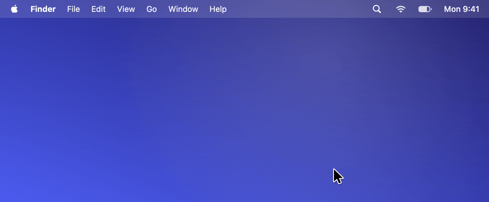

<p align="center">
  
</p>

<h1 align="center">LightSpot</h1>

<p align="center">Returns the clickable Spotlight search button to the macOS 27 menu bar.</p>

---

With Siri AI turned on, macOS 27 removes the Spotlight magnifying glass from the menu bar. The Siri button that replaces it only starts voice input, so there's nothing left to click if you want to type a search.

LightSpot adds a magnifying glass to the menu bar. Click it and the normal search bar opens, ready for typing.

<p align="center">
  
</p>

## Install

1. Download the latest `LightSpot-x.y.z.dmg` from [Releases](https://github.com/MarinadedDuck/LightSpot/releases).
2. Open it and drag **LightSpot** into **Applications**.
3. Open LightSpot from Applications. The welcome window walks you through the one permission it needs.

Requires macOS 27 or later.

## Usage

- **Click** the magnifying glass to open the search bar.
- **Right-click** it for Settings and Quit.
- **Open LightSpot again from Applications** to reach Settings. This is the way back in if the icon has been hidden in System Settings → Menu Bar.
- From Shortcuts or a script, `open lightspot://open` opens the search bar and `open lightspot://settings` opens Settings.

## Questions

**Where did the Spotlight icon go in macOS 27?**
When Siri AI is turned on, macOS 27 removes the Spotlight magnifying glass from the menu bar and puts a Siri button in its place. That button only starts voice input. ⌘Space still opens Spotlight, but there's nothing left to click. LightSpot adds a button back.

**Does LightSpot replace Spotlight?**
No. It opens Apple's own Spotlight search bar, the same one ⌘Space opens. Your results, settings and shortcuts don't change.

**Is it free?**
Yes. It's free and open source under the MIT license, with no ads, accounts or tracking. Releases are signed and notarized by Apple.

## Why does it need Accessibility permission?

LightSpot opens the search bar by pressing your “Show Spotlight search” keyboard shortcut (⌘Space unless you've changed it) for you. macOS only lets an app send keystrokes if you allow it in **System Settings → Privacy & Security → Accessibility**.

LightSpot also uses that permission to bring itself to the front for a moment before pressing the shortcut. Without that step, apps that capture system shortcuts, such as Screen Sharing, remote desktop clients and virtual machines, would send ⌘Space to the remote machine. If you dismiss search, LightSpot returns you to the app you were using.

LightSpot doesn't read your keystrokes or look at your screen. The whole app is a few hundred lines of Swift you can read in [`LightSpot/`](LightSpot).

If you've changed the Spotlight shortcut, LightSpot reads the new one from System Settings. If you've turned the shortcut off, LightSpot tells you so and shows where to turn it back on.

## Updates

LightSpot uses [Sparkle](https://sparkle-project.org) to update itself. The second time LightSpot starts, it asks whether to check for updates automatically. If you say yes, it downloads a small file from GitHub once a day to see if there's a new version. Nothing about you or your Mac is sent. This is the only time LightSpot connects to the network. You can turn it off in Settings, or check by hand with **Check for Updates…** in the right-click menu.

Updates are signed, and LightSpot only installs ones signed by the maintainer.

## Building from source

You need Xcode 27 and [XcodeGen](https://github.com/yonaskolb/XcodeGen).

```bash
brew install xcodegen
xcodegen generate
open LightSpot.xcodeproj
```

Builds are signed to run locally, so you don't need an Apple developer account. macOS sees each locally signed build as a new app, so after rebuilding you may need to turn LightSpot off and on again in **System Settings → Privacy & Security → Accessibility**. To sign with your own team, which avoids that, see [`Config/Signing.xcconfig`](Config/Signing.xcconfig).

`project.yml` is the source of truth; `LightSpot.xcodeproj` and `LightSpot/Info.plist` are generated from it. Debug builds don't check for updates, so your own build won't be replaced by a release. Maintainers can find release steps in [RELEASING.md](RELEASING.md).

## Contributing

Bug reports and fixes are welcome.

- **Found a bug?** [Open an issue](https://github.com/MarinadedDuck/LightSpot/issues) with your macOS version, what you did and what happened.
- **Want to fix something?** Send a pull request. LightSpot is meant to stay small and do one thing, so for new features, open an issue first so we can talk it through.
- **Found a security problem?** Please don't open a public issue. Use **Report a vulnerability** on the [Security tab](https://github.com/MarinadedDuck/LightSpot/security) instead.

## Credits

Created by Kevin Luttman at [Case Study Creative](https://www.casestudycreative.ca/apps), with help from [contributors](https://github.com/MarinadedDuck/LightSpot/graphs/contributors).

## License

[MIT](LICENSE). LightSpot isn't affiliated with Apple. Spotlight and Siri are trademarks of Apple Inc.
